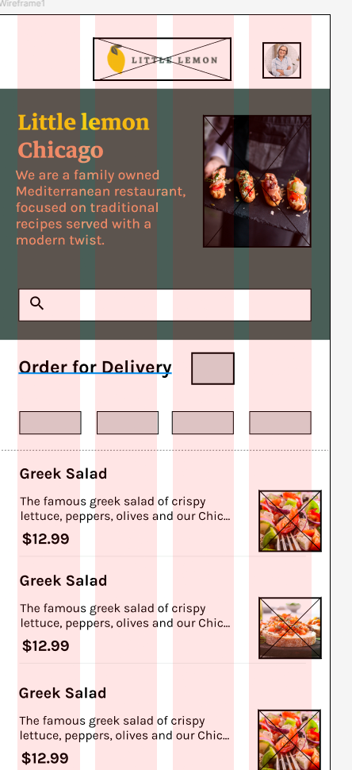

Heres a screenshot of my wireframe:

Please keep in mind, some of the images are just black squares because the JSON file has them as such, this is not an error in my code you can see here for example https://github.com/Meta-Mobile-Developer-PC/Working-With-Data-API/blob/main/images/lemonDessert%202.jpg?raw=true
that this is just a black square.

Thank you for taking your time to look at my final project.
